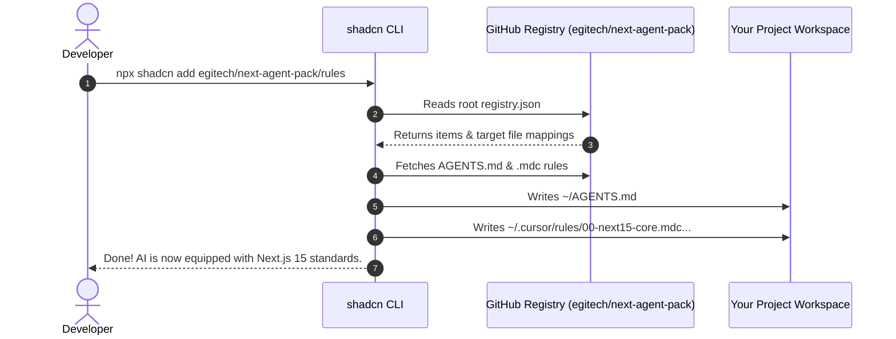

# 🚀 next-agent-pack

> **The composable rule pack and engineering standards for AI Coding Agents (Cursor & Antigravity) in Next.js 15 and React 19.**  
> *Distributed via the official [shadcn GitHub Registry](https://ui.shadcn.com/docs/registry/github) specification and zero-config curl installer.*

[](LICENSE)
[](https://nextjs.org/)
[](https://react.dev/)
[](https://tailwindcss.com/)
[](https://ui.shadcn.com/docs/registry/github)

---

## ⚡ The Problem: AI Hallucinations in Next.js 15 & React 19

Next.js 15 and React 19 introduced massive paradigm shifts:
- **Async Request APIs**: `params` and `searchParams` are now asynchronous Promises (calling `props.params.slug` synchronously crashes at runtime).
- **Uncached Fetch Defaults**: `fetch` requests and Route Handlers are no longer cached by default (`cache: 'no-store'`).
- **React 19 Modern Hooks**: `useActionState` replaces deprecated `useFormState`, native `ref` props replace `forwardRef`, and `useOptimistic` powers instant UI feedback.

Without strict system rules, AI Coding Assistants (Cursor, Antigravity, Claude, Copilot) frequently hallucinate outdated patterns from Next.js 13/14 or React 18, generating broken code.

**`next-agent-pack`** injects clean, token-optimized engineering rules so your AI assistant writes production-ready Next.js 15 code from your very first prompt.

---

## 📦 Quick Installation

You can install `next-agent-pack` using either the **official shadcn CLI** or a **1-line curl script**:

### Method 1: Using shadcn CLI (Official GitHub Registry)

If your Next.js project is configured with `shadcn`, install directly with zero setup:

```bash
# 1. Install Full Pack (Antigravity AGENTS.md + 4 Cursor .mdc rules):
npx shadcn@latest add egitech/next-agent-pack/rules

# 2. Or install only Antigravity AGENTS.md:
npx shadcn@latest add egitech/next-agent-pack/agents-md

# 3. Or install only Cursor .mdc rules:
npx shadcn@latest add egitech/next-agent-pack/cursor-rules
```

### Method 2: Using 1-Line Curl Script (Universal)

Works on any project without needing the `shadcn` CLI installed:

```bash
# Install everything (Cursor rules + Antigravity AGENTS.md & Skill):
curl -fsSL https://raw.githubusercontent.com/egitech/next-agent-pack/main/install.sh | bash

# Or install specifically for Cursor (.cursor/rules/*.mdc):
curl -fsSL https://raw.githubusercontent.com/egitech/next-agent-pack/main/install.sh | bash -s cursor

# Or install specifically for Antigravity (AGENTS.md & Skill):
curl -fsSL https://raw.githubusercontent.com/egitech/next-agent-pack/main/install.sh | bash -s antigravity
```

---

## 💡 How It Works: The 2-File GitHub Registry Principle

According to the official [shadcn GitHub Registry specification](https://ui.shadcn.com/docs/registry/github), any public GitHub repository can serve as a decentralized code and rules registry with **just 2 essential components**:

1. **`registry.json` (The Catalog Index)**: Sits at the root of the repository, declaring available items, file sources (`path`), and user destinations (`target`).
2. **The Source Files**: The raw markdown or code files distributed to consumers.



---

## 🤖 Multi-Agent Compatibility

`next-agent-pack` unifies the top AI coding tools into a single source of truth:

| AI Coding Agent | Configuration File | Loading Mechanism |
| :--- | :--- | :--- |
| **Cursor AI** | `.cursor/rules/*.mdc` | **Context Scoping**: Auto-activates based on `globs` matching files currently open in the editor. |
| **Google Antigravity (Rules)** | `AGENTS.md` | **Hierarchical Context**: Project-wide engineering instructions loaded at session startup. |
| **Google Antigravity (Skill)** | `.agents/skills/next-agent-pack/SKILL.md` | **Progressive Disclosure**: Detailed guidelines read on-demand only when tackling relevant tasks. |

---

## 🧩 Included Rules Overview

| Rule File | Domain | Core Guidelines Enforced |
| :--- | :--- | :--- |
| **`00-next15-core.mdc`** | Next.js 15 Core | Mandatory `await params` / `await searchParams`, Server Components by default, validated Server Actions (`'use server'`), and Next.js 15 un-cached `fetch` defaults (`no-store`). |
| **`01-react19-modern.mdc`** | React 19 Hooks | Form mutations with `useActionState` (deprecates `useFormState`), optimistic UI with `useOptimistic`, Suspense promise streaming with `use()`, and direct `ref` props (no `forwardRef`). |
| **`02-tailwind-styling.mdc`** | Tailwind CSS | Strict class merging with `cn()` utility (`clsx` + `tailwind-merge`), logical class ordering, semantic CSS variable tokens (`bg-background`, `text-primary`), and mobile-first responsiveness. |
| **`03-shadcn-components.mdc`** | shadcn/ui Arch | Clean directory separation between `components/ui/*` primitives and composite feature components, `cva` variant definitions, and polymorphic `asChild` composition via Radix Slot. |

---

## 🏗️ Composable Architecture (Lego Registry)

`next-agent-pack` separates raw modular rules from assembled distributions:

```text
next-agent-pack/
├── registry.json                       # Official shadcn GitHub Registry index
│
├── registry/                           # Atomic modular source blocks
│   ├── frameworks/
│   │   ├── nextjs-15/                  # Next.js 15 core rules & metadata
│   │   └── react-19/                   # React 19 hooks & patterns
│   └── ui/
│       ├── tailwind/                   # Tailwind styling & tokens
│       └── shadcn/                     # shadcn/ui component architecture
│
├── stacks/                             # Presets assembling atomic blocks
│   └── next15-shadcn-minimal/          # Manifest linking registry modules
│
├── dist/                               # Pre-compiled bundles ready for distribution
│   └── next15-shadcn/
│       ├── 00-next15-core.mdc
│       ├── ...
│       ├── AGENTS.md                   # Antigravity project rules
│       └── skills/next-agent-pack/     # Antigravity progressive skill
│
├── scripts/
│   ├── build.mjs                       # Bundler compiling dist/ and root assets
│   └── validate.mjs                    # Linter verifying frontmatter, token limits, and registry.json
│
├── install.sh                          # 1-line installer script
└── AGENTS.md                           # Self-hosting rules for developing this repository
```

---

## 🛡️ Upgradability & Safe Customization (Namespacing)

To safely update `next-agent-pack` in your repository without overwriting custom company or personal rules:

- **`0x-*.mdc`**: **System Rules** managed by `next-agent-pack` (safe to re-run installer/update).
- **`9x-*.mdc`**: **Your Custom Team Rules** (e.g. `90-company-guidelines.mdc`). The installer and registry will **never** overwrite `9x-*.mdc` files.

---

## 🛠️ Development & Contributing

### Prerequisites
- Node.js >= 18

### Commands
```bash
# Compile dist bundles, AGENTS.md, and local .cursor rules:
npm run build

# Validate frontmatter, token limits (< 1500 words/rule), and registry.json integrity:
npm test
```

### Contributing Workflow
1. Fork the repo and create your branch (`git checkout -b feat/add-drizzle-rule`).
2. Add or update rules in `registry/`.
3. Run `npm run build && npm test`.
4. Commit your changes and submit a Pull Request!

---

## 📄 License

Distributed under the MIT License.
